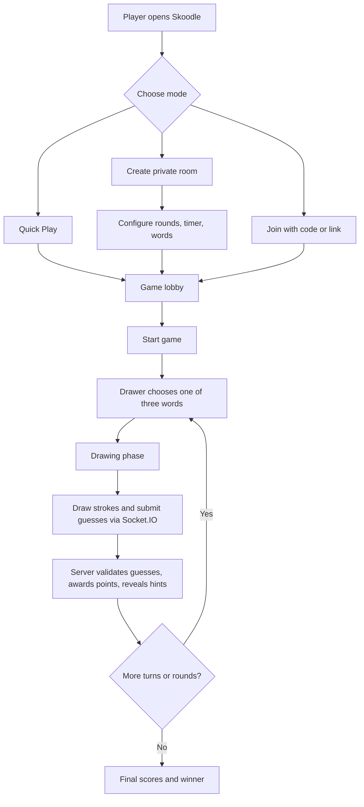

# Skoodle 🎨

**Skoodle** is a real-time multiplayer drawing-and-guessing web game. Create a private room, invite friends with a room link, take turns drawing, and race to guess the word before time runs out.

Built with **React, TypeScript, Vite, Node.js, Express, and Socket.IO**.

## Features

- **Private rooms:** Create a room and invite friends using a room code or shareable link.
- **Quick Play:** Join through the quick-play flow.
- **Configurable games:** The host can choose 2–10 rounds, a 30/60/80/120-second drawing timer, and default or custom words.
- **Turn-based gameplay:** The drawer chooses from three word options; other players guess through chat.
- **Real-time drawing:** Canvas updates are shared with players in the same room.
- **Progressive hints:** Letters are revealed at approximately 25%, 50%, and 75% of the drawing time, regardless of the selected duration.
- **Time-based scoring:** Faster correct guesses earn more points (20–100, rounded to increments of five).
- **Guess feedback:** Correct guesses earn points without revealing the answer in chat; near misses receive private feedback.
- **Reconnect and sync:** Returning players can recover the current round state, drawing, and hints through the session-reconnect flow.
- **Game results:** Players can see the winner and final scores at the end of a game.

## Tech Stack

| Layer | Technologies |
| --- | --- |
| Frontend | React, TypeScript, Vite, CSS |
| Backend | Node.js, Express |
| Real-time communication | Socket.IO |
| Game state | Server-side game engine and room management |
| Drawing | HTML Canvas and synchronized drawing events |

## How It Works



The **server is authoritative** for room membership, word selection, game phases, round deadlines, hints, and scoring. Socket.IO delivers gameplay events to connected clients, while the frontend renders the canvas, chat, scoreboard, and countdown.

### Progressive hint timing

Hints are based on **percentage of the turn elapsed**, not fixed seconds. For example:

| Turn elapsed | Hint behavior |
| --- | --- |
| 0% | All letters hidden |
| 25% | Reveal one letter |
| 50% | Reveal a second letter |
| 75% | Reveal a third letter |

The game never reveals the entire word through hints before the turn ends. Short words reveal fewer letters.

## Getting Started

### Prerequisites

- Node.js and npm
- Two browser tabs or devices to test multiplayer gameplay

### 1. Clone the repository

```bash
git clone <YOUR_REPOSITORY_URL>
cd <YOUR_REPOSITORY_FOLDER>
```

### 2. Install dependencies

Install dependencies separately for the frontend and backend. Adjust directory names if your repository uses different names:

```bash
cd frontend
npm install

cd ../backend
npm install
```

### 3. Configure the connection

Ensure the frontend Socket.IO client connects to your running backend. Set any required environment variables according to your project's `socket` configuration and backend server entry point.

### 4. Start the application

In separate terminals, run the frontend and backend development scripts defined in their respective `package.json` files. For example, if both packages define a `dev` script:

```bash
# Terminal 1
cd backend
npm run dev
```

```bash
# Terminal 2
cd frontend
npm run dev
```

Open the local URL printed by Vite. **Note:** Confirm the exact folder names, scripts, ports, and environment-variable names in your repository before publishing these setup instructions.

## Playing a Game

1. Enter a player name.
2. Create a private room, use Quick Play, or join a friend's room.
3. For private rooms, choose the number of rounds, drawing duration, and word list.
4. Share the room code or invitation link with friends.
5. Start the game. The current drawer selects a word and begins drawing.
6. Other players submit guesses. Correct guesses score points; hints appear as time passes.
7. Continue through the configured rounds and view the final results.

> Invitation links work across devices after the frontend and backend are deployed and the frontend host is configured to serve the app for `/room/:code` URLs.

## Real-Time Events

Some of the Socket.IO events used by Skoodle include:

| Event | Purpose |
| --- | --- |
| `room:create` | Create a private room with settings |
| `room:join` | Join an existing room |
| `room:quickPlay` | Enter quick play |
| `room:reconnect` | Restore a player session |
| `game:start` | Start a private game |
| `game:wordChoices` | Send word options to the drawer |
| `game:selectWord` | Submit the drawer's selected word |
| `game:drawingStarted` | Announce the drawing phase and deadline |
| `game:hintUpdated` | Broadcast a newly revealed hint |
| `chat:message` | Send chat messages and guesses |
| `game:correctGuess` | Announce a successful guess and points |
| `game:sync` | Retrieve the current game snapshot |
| `game:turnEnded` | Reveal the previous word |
| `game:finished` | Announce the winner and final scores |

## Project Structure

The codebase is organized around these components (exact paths may vary):

```text
frontend/
  src/
    pages/
      HomePage.tsx
      LobbyPage.tsx
      GamePage.tsx
    hooks/
      useGameState.ts
    services/
      socket.ts
      playerSession.ts
    ...
backend/
  ...
  GameEngine.js
  WordManager.js
  DrawingManager.js
  RoomService.js
  ...
```

## Security and Reliability

The backend validates room settings and controls secret-word selection and scoring. The selected word is sent only to the drawer during the drawing phase, while guessers receive a masked word and progressive hints.

**In progress:** Additional abuse protection for chat and drawing traffic, including per-player rate limits, payload-size limits, and stroke validation. These controls should be enforced server-side before broadcasting events.

For larger deployments, consider shared session/game-state storage, distributed rate limiting, and scaling Socket.IO across multiple server instances.

## Roadmap

- [x] Private rooms and invite links
- [x] Host-configurable rounds, drawing duration, and word lists
- [x] Real-time drawing and guessing
- [x] Server-authoritative turn timing and scoring
- [x] Progressive letter hints
- [x] Reconnect and game-state synchronization
- [ ] Chat and stroke rate limiting with payload validation
- [ ] End-of-game drawing replay
- [ ] Production deployment and monitoring

## License

Add a `LICENSE` file if you want to specify how others may use, modify, and distribute this project.
